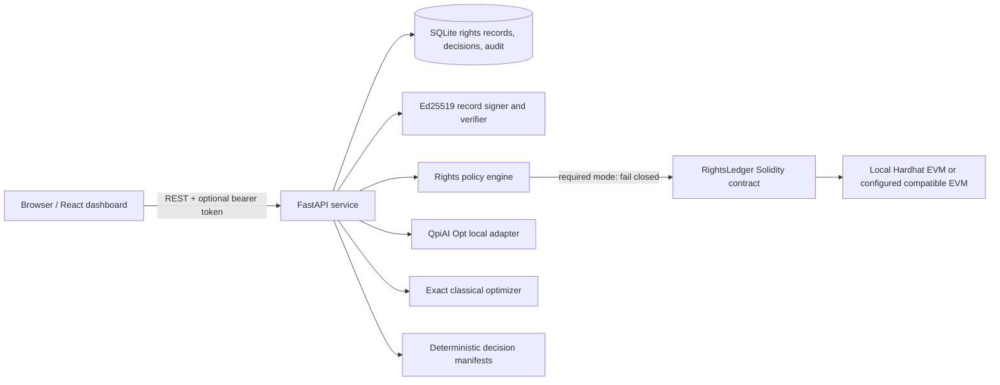

# BhashaChain architecture

React/Vite calls FastAPI. The API stores records and decisions in SQLite, signs canonical licence metadata with Ed25519, and applies expiry, revocation, purpose, geography, content-hash, version, derivative, and redistribution checks. The browser is a presentation layer. Signing keys, blockchain signers, QpiAI keys, and policy enforcement stay in the backend.

The Solidity ledger owner (the deployer) explicitly grants provider registration access. Only allowlisted providers can register; the full signed rights record and raw corpus are not stored on-chain. The backend checks receipts, the expected event, current contract state, and that the stored issuer matches the configured signer before it trusts a chain registration. The ledger stores a deterministic dataset identifier hash, content hash, issuer address, numeric licence version, permission terms, expiry, revocation state, and registration time.

Eligibility filtering happens before both optimizers. The QpiAI Opt adapter uses its SDK and reports solver mode and diagnostics; it does not label a different solver as QpiAI. An exact classical baseline independently checks language coverage, mandatory IDs, and budget. The optional QpiAI Quantum simulator experiment is independent of rights checks and optimization.

`BLOCKCHAIN_MODE=disabled` allows an explicitly local, off-chain demonstration. `optional` checks the chain when available but records failures as evidence. `required` rejects rights checks when chain evidence is missing, stale, mismatched, denied, or unavailable.

Decision manifests are deterministic snapshots of recorded decisions. Audit events are linked by SHA-256 previous-event hashes. Those controls make accidental or local database tampering detectable, but a single operator controlling the database can rewrite the full chain; an external anchor would be needed for independent immutability.

Production deployment uses a static frontend and an independent API service. Configure `VITE_API_BASE_URL` on Netlify and `CORS_ORIGINS` on the API host. The included Render free-service blueprint has ephemeral filesystem storage: use a durable database service before treating hosted data as persistent.
